# SmartCar Ops

**Detecting, scoring and prioritising road obstacles with computer vision — from a toy car on a tape track to real dashcam footage.**

SmartCar Ops is a student IoT project. It combines three parts:

1. **A hardware prototype**: an Arduino car that follows a black-tape track on its own and drives around obstacles. A separate ESP32-CAM streams the car's point of view over Wi-Fi.
2. **Computer-vision models**: three YOLO26 detectors, one for road users, one for road hazards and one for the obstacles of our track. Two of them we trained ourselves.
3. **A supervision web app**: built with Dash, Plotly and Docker. It runs the models in real time, scores each obstacle's severity, ranks obstacles by priority, places them on a map and plans the safest route.

The same pipeline runs in two environments: **Real world** (a simulated fleet on the real street network of Paris' Latin Quarter, with real dashcam videos analysed by the models) and **Prototype** (our toy car on its track).

<p align="center">
  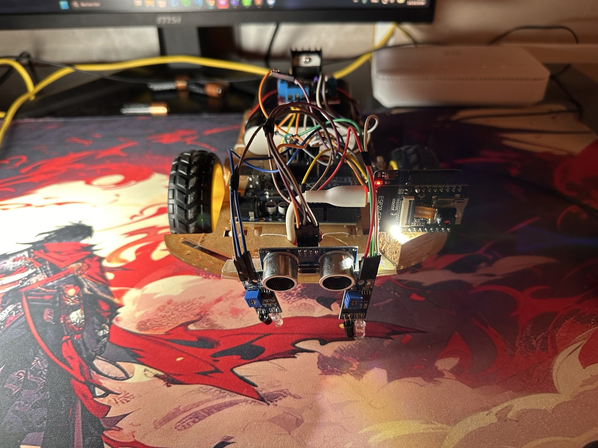
  &nbsp;
  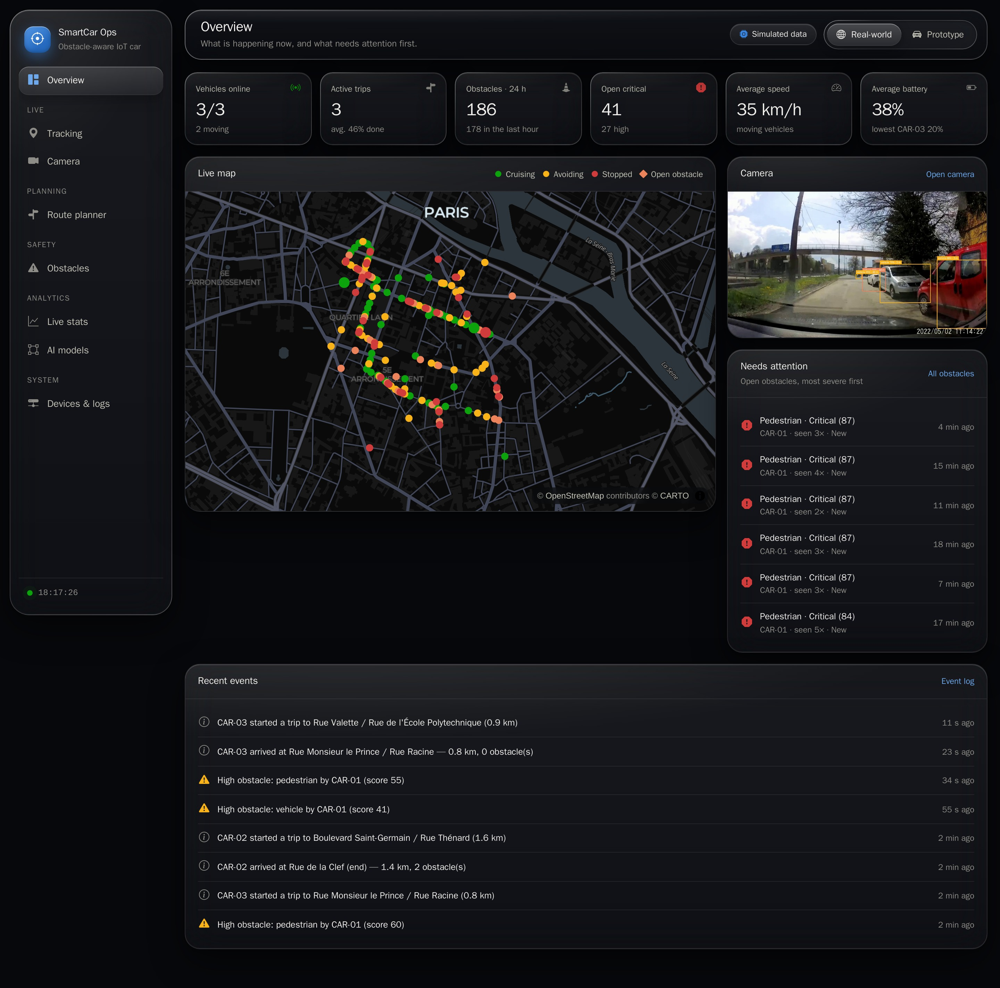
</p>

> 📄 **Full report (French, 86 pages):** [`rapport/main.pdf`](rapport/main.pdf). This README summarises it.
> Module *Internet des objets* · FST Béni Mellal · 2025/2026 · supervised by **Pr. BASLAM Mohamed**.

---

## Contents

- [Architecture](#architecture)
- [1. Hardware prototype](#1-hardware-prototype)
- [2. Computer vision](#2-computer-vision)
- [3. From detection to decision](#3-from-detection-to-decision)
- [4. The SmartCar Ops application](#4-the-smartcar-ops-application)
- [Quick start](#quick-start)
- [Repository layout](#repository-layout)
- [Credits](#credits)

---

## Architecture

The system follows the four classic IoT layers: perception, network, processing and application.

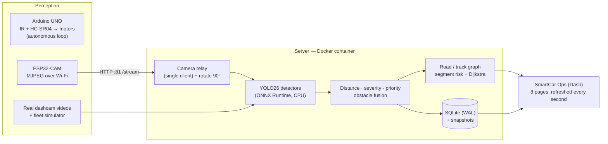

There is **no link between the Arduino and the ESP32-CAM**. The Arduino has no Wi-Fi, so everything the server knows about the toy car comes from the camera image. The ESP32-CAM accepts only one viewer at a time: the server is that viewer, and it relays the stream to every browser tab. Because the camera's IP address changes, the server finds it automatically: last known IP first, then a scan of the local network.

A second, offline container (Ultralytics + JupyterLab, GPU) is used for training.

---

## 1. Hardware prototype

<p align="center">
  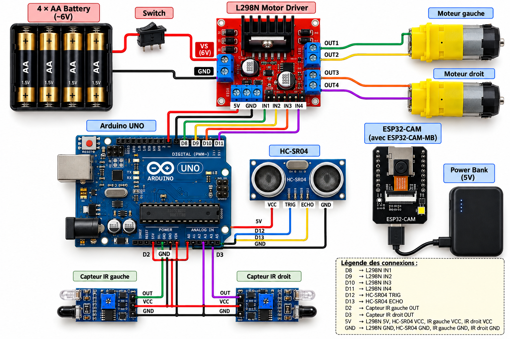
</p>

| Component | Role |
|---|---|
| **Arduino UNO** (ATmega328P) | Runs the driving program: reads the sensors and drives the motors |
| **L298N** dual H-bridge | Supplies the motor current the Arduino cannot. IN1–IN4 set each motor's direction; speed by PWM (190/255) |
| **2 × TT gear motors** + caster wheel | Differential drive |
| **2 × IR reflective sensors** | Follow the black tape (black absorbs infrared) |
| **HC-SR04** ultrasonic sensor | Measures the distance ahead, d [cm] ≈ t [µs] / 58 |
| **ESP32-CAM** (OV3660) + MB board | Streams VGA 640×480 MJPEG over Wi-Fi (CameraWebServer firmware) |

**Wiring**

| From | To |
|---|---|
| Arduino D8, D9, D10, D11 | L298N IN1, IN2, IN3, IN4 |
| Arduino D12 / D13 | HC-SR04 Trig / Echo |
| Arduino D2 / D3 | Left / right IR sensor OUT |
| Arduino 5 V / GND | L298N 5 V, HC-SR04, IR sensors (common ground) |
| 4 × AA (≈ 6 V) → switch | L298N VS: motors only |
| USB power bank (5 V) | ESP32-CAM (through its MB board) and Arduino |

The two power sources are kept separate on purpose: the motors' current spikes would make the ESP32 reboot (brownout) while it transmits over Wi-Fi. The L298N drops about 2 V, so the motors get roughly 4 V.

**Layout.** At the front are the HC-SR04, the two IR sensors pointing down a few millimetres above the track, and the ESP32-CAM mounted *on its side* (the server turns its image back 90°). The Arduino sits in the middle, and the L298N sits on the power bank at the back, next to the motors.

### Embedded logic ([`firmware/arduino_car/arduino_car.ino`](firmware/arduino_car/arduino_car.ino))

On every loop the HC-SR04 measures the distance. If it is **13 cm or less**, the car drives around the obstacle. Otherwise it follows the line:

| IR left / right (0 = floor, 1 = black tape) | Action |
|---|---|
| 0 0 or 1 1 | go straight |
| 0 1 | turn right (right wheel stops) |
| 1 0 | turn left (left wheel stops) |

**Detour sequence** (timings tuned by hand on our track): 90° pivot (0.51 s) → forward 0.7 s → 90° pivot (0.35 s) → forward 0.6 s → 90° pivot (0.33 s) → forward until an IR sensor finds the tape again. Each pivot uses a single wheel, which avoids the stall that happens when a TT motor pair tries to spin on the spot. The car **never stops in front of an obstacle**: it goes around it on the inside of the loop (≈ 3.4 s) and goes back to following the line. The dashboard reuses exactly these values to simulate the car and draw its estimated detour path.

**Test track.** A loop of black tape on light tiles, with 6 checkpoints (A–F) and two cream boxes as obstacles, one in the middle of each long side.

---

## 2. Computer vision

### Models

| Model | Variant | Classes | Training |
|---|---|---|---|
| **Road users** | YOLO26n | pedestrian, cyclist, vehicle, animal | none: COCO-pretrained, COCO classes regrouped |
| **Road hazards** | YOLO26s | pothole, cone, barrier, roadwork sign | fine-tuned 8 h (36 epochs) on 7,894 dashcam images |
| **Prototype obstacles** | YOLO26n | column, box | fine-tuned 30 min (73 epochs) on our own track images |

YOLO26 (Ultralytics, 2025) is a one-stage detector with an end-to-end head, so **no NMS post-processing is needed**. Its ONNX output directly gives 300 detections `(x1, y1, x2, y2, score, class)`. We used *nano* and *small* variants because inference runs on a laptop CPU. All three models run in the app through **ONNX Runtime**; the app needs no PyTorch at all.

### Data

**Real roads.** We combined two public dashcam datasets: *Potholes under challenging conditions* (Bučko et al., *Sensors* 2022, CC BY 4.0) and *ROADWork* (Ghosh et al., ICCV 2025, CMU, ODC-By 1.0). That gives 7,894 images, with their many sub-categories merged into 4 classes and split **6,324 / 755 / 815** (train / val / test). ROADWork keeps its official geographic split, so **the test images come from places never seen in training**.

**Prototype.** No public dataset contains our track, so we built our own:

- **Video.** 249 frames from a phone video shot at car height.
- **Labelling with SAM 2.** One click per object in the first frame; SAM 2 then follows its mask through the whole video. A filter removes the black-tape pixels, and the box is taken from the mask. All 141 boxes were checked by eye.
- **ESP32-CAM-style augmentation.** 60 % of the images are cropped to 4:3, downsized to 320×240, blurred, given noise and JPEG compression, so that phone footage looks like the real camera.
- **Copy-paste.** Obstacles are cut out with their masks and pasted on empty track: 400 extra images with exact boxes.
- **Time-based split.** Two neighbouring video frames are almost identical, so a random split would inflate the scores. We split by time instead.

<p align="center">
  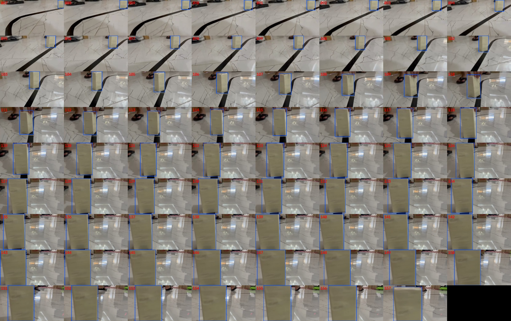
</p>

### Training

The training environment is Docker (`ultralytics/ultralytics` + JupyterLab) on a **GTX 1650 Ti (4 GB)**. Mixed precision is unstable on this GPU, so training runs in FP32 with a batch of 4 for the *small* model. The road model was trained under an 8-hour time budget. Its validation mAP was **still rising at the end**, so a longer run would improve it.

| | Road hazards | Prototype |
|---|---|---|
| Start weights | `yolo26s.pt` (COCO) | `yolo26n.pt` (COCO) |
| Input size | 640 × 640 | 320 × 320 |
| Batch | 4 | 16 |
| Length | 8 h budget (36 epochs) | max 80 epochs (early stop at 73) |
| LR | 0.01, cosine decay | 0.01, cosine decay |

Notebooks: [`training/train_road_obstacles.ipynb`](training/train_road_obstacles.ipynb) and [`training/train_toy_obstacles.ipynb`](training/train_toy_obstacles.ipynb), generated by `build_notebook.py` and `build_toy_notebook.py`. Metrics and figures are in [`training/report/`](training/report/).

### Results (test sets, never used for training or tuning)

**Road hazards**: 815 test images, 5,105 objects.

| Class | Objects | P | R | mAP@50 | mAP@50-95 | mAP@50 (960 px + TTA) |
|---|---:|---:|---:|---:|---:|---:|
| pothole | 299 | 0.601 | 0.254 | 0.312 | 0.108 | 0.330 |
| cone | 2,358 | 0.712 | 0.715 | 0.694 | 0.416 | 0.744 |
| barrier | 1,977 | 0.692 | 0.539 | 0.578 | 0.317 | 0.634 |
| roadwork sign | 471 | 0.638 | 0.495 | 0.520 | 0.367 | 0.588 |
| **all** | **5,105** | **0.661** | **0.501** | **0.526** | **0.302** | **0.574** |

- **Real-time setting.** The app uses 640 px. The 960 px + TTA setting is 5× slower, so it is only an offline reference.
- **Finding the obstacle.** If the class doesn't have to be exact (class-agnostic evaluation), mAP@50 is **0.63** in real time and **0.68** at best. Confusions between classes are rare (≤ 3 %); most errors are missed objects.
- **Confidence threshold.** It sets the trade-off: at **0.70**, precision is **0.92** but recall drops to 0.30.
- **Potholes are the hard class.** There are few of them, they are flat, and they vary a lot.

<p align="center">
  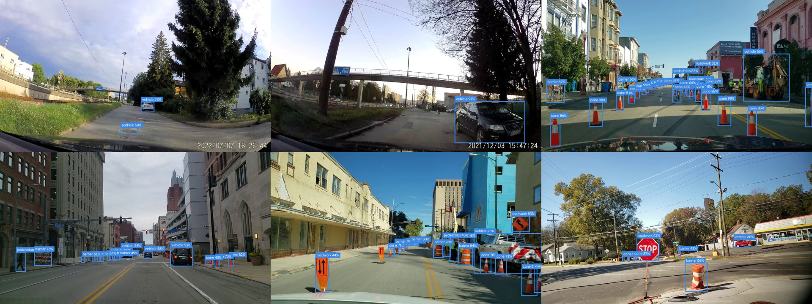
</p>

**Prototype obstacles**: 26 real test images, 15 obstacles (6 columns, 9 boxes), plus the same images in ESP32-CAM style.

| Test set | P | R | F1 | mAP@50 | mAP@50-95 |
|---|---:|---:|---:|---:|---:|
| Original images (832 × 464) | 0.989 | 1.000 | 0.994 | 0.995 | 0.976 |
| ESP32-CAM style (320 × 240) | 0.991 | 1.000 | 0.995 | 0.995 | 0.921 |

At the app's threshold (0.40), all 15 obstacles are found with the right class and there are no false detections. These numbers should be read with care: the test set is small and comes from the same video as training (same light, same floor).

**On the real ESP32-CAM**, the camera is mounted on its side. Without rotating the frame the model detects nothing; with the frame turned upright, the box is detected at **95 %**. Objects never seen in training (brown furniture, a hand in front of the lens) were sometimes taken for a column. The app can record real ESP32-CAM frames so these cases can be added to the next training.

<p align="center">
  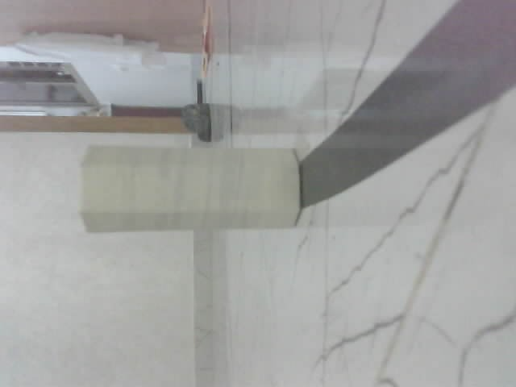
  &nbsp;
  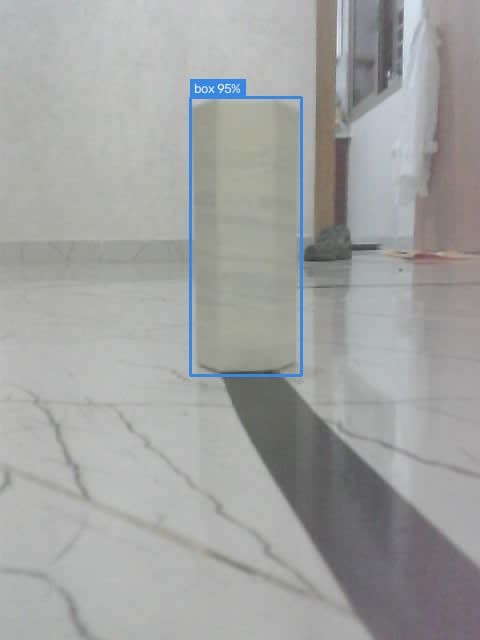
</p>

**Speed**

| Model and conditions | Time per frame | Rate |
|---|---:|---:|
| Road hazards, GPU, 640 px | 10 ms | — |
| App, CPU: road users + hazards in parallel | 190–730 ms | 1.4–5 fps |
| App, CPU: prototype model (480 × 640) | ≈ 70 ms | ≈ 14 fps |

---

## 3. From detection to decision

Detecting an obstacle is not enough; the system also has to decide what to do about it.

**Distance.** Each detection is placed on the map. Its distance is estimated from the box height and the object's known size (≈ 1.7 m for a pedestrian, 0.7 m for a cone), or from its vertical position in the image for flat objects like potholes. It counts as *in the path* when it is in the centre of the image. Repeated sightings are merged into one obstacle with a counter.

**Severity score, 0–100.**

```
score = 100 × w_class × (0.5 + 0.5 × proximity) × confidence × (1 if in path, 0.5 otherwise)
```

The class weights can be edited in the app (pedestrian 1, pothole 0.6, cone 0.4…). A score ≥ 60 is **critical**, 40–60 **high**, 20–40 **medium** and < 20 **low**. Example: a close pedestrian (p = 0.6) seen at 90 % in the path scores 100 × 1 × 0.8 × 0.9 × 1 = **72 (critical)**; a cone on the side under the same conditions scores **14 (low)**.

**Safest route.** Each road segment (or track segment) gets a risk:

```
risk(e) = Σ over obstacles of  score/100 × w_status × 0.5^(age / half-life)
cost(e) = length(e) + α × U × risk(e)
```

- **Status.** Resolved obstacles count for 30 %, false positives are ignored.
- **Half-life.** 7 days in the real world, 2 days on the track.
- **U.** The distance one unit of risk is worth: 150 m in the real world, 60 cm on the track.
- **α.** The operator's slider, from 0 (shortest) to 8 (safest).

Dijkstra (NetworkX) returns three routes: **Recommended**, **Shortest** and **Safest**. One real example: *+43 % distance, 50 % less risk, 35 open obstacles avoided*.

---

## 4. The SmartCar Ops application

**How it is built.** Python, **Dash + Plotly**, deployed with **Docker** (`docker compose up`). Background services (camera relay, dashcam, simulators, detectors) feed an in-memory hub and a SQLite database. Pages refresh every second. Inference runs in its own thread and always works on the latest frame, so the interface stays smooth however fast the models are. One switch in the top bar changes the environment: the pages and the calculations stay the same, and units change between metres and centimetres.

| Page | What it shows |
|---|---|
| **Overview** | Live map, key numbers, obstacles needing attention, recent events |
| **Tracking** | Vehicles, live positions and trails, trip history with replay |
| **Camera** | ESP32-CAM stream or CAR-01 dashcam with the models' boxes |
| **Route planner** | Shortest / safest / recommended routes, track editor, ArUco markers |
| **Obstacles** | Priority queue: review, acknowledge, resolve or mark as false positive (excluded from route risk, kept as training data) |
| **Live stats** | KPIs, speed, states, obstacles per hour / class / severity |
| **AI models** | Offline test metrics and on-the-road behaviour of each model |
| **Devices & logs** | Health of camera, simulators, models and database; event log; severity weights |

| Real world | Prototype |
|---|---|
| 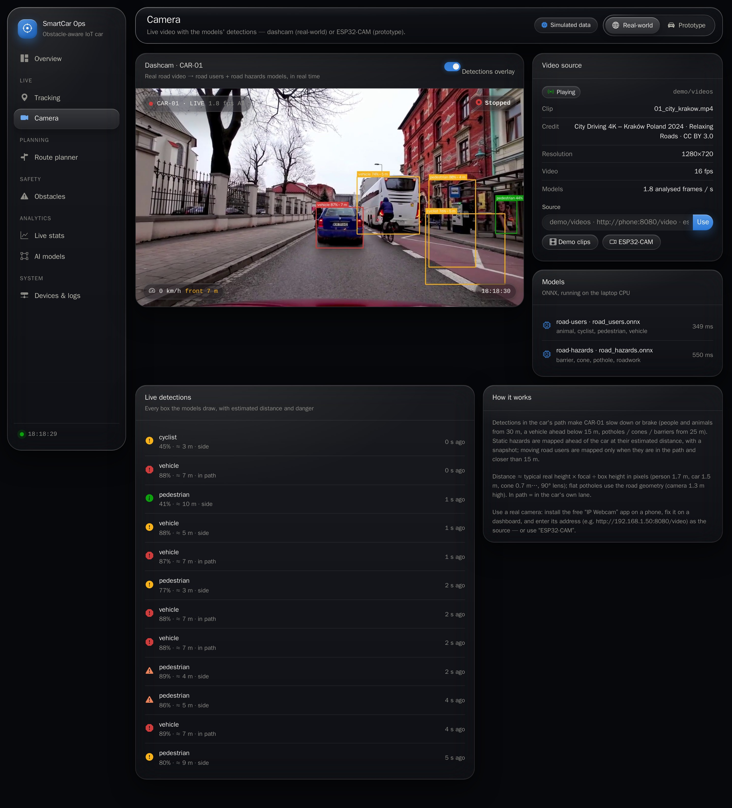 | 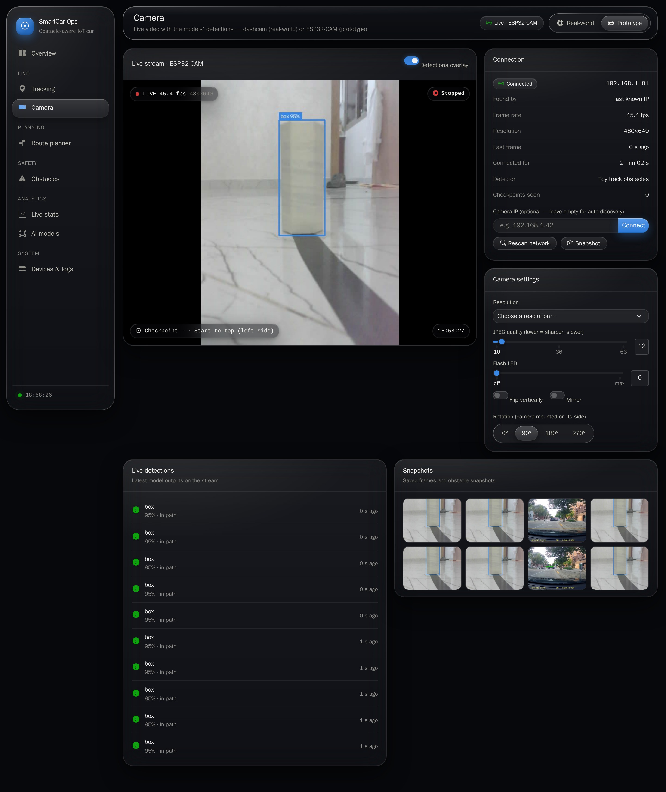 |
| 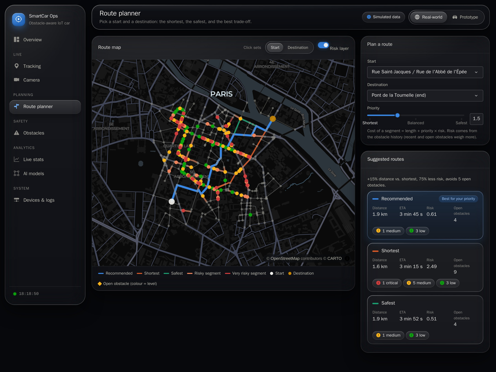 | 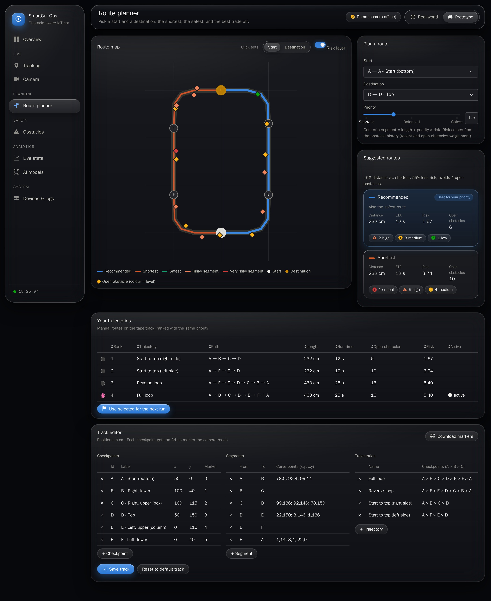 |
| 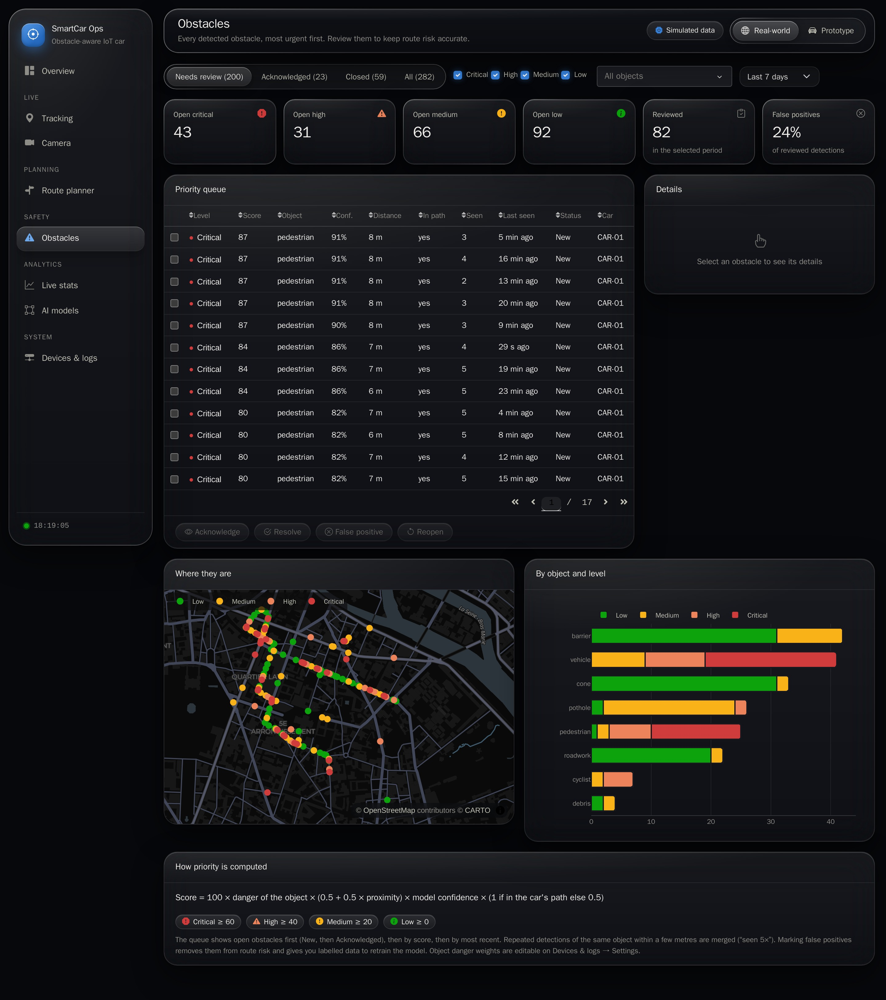 | 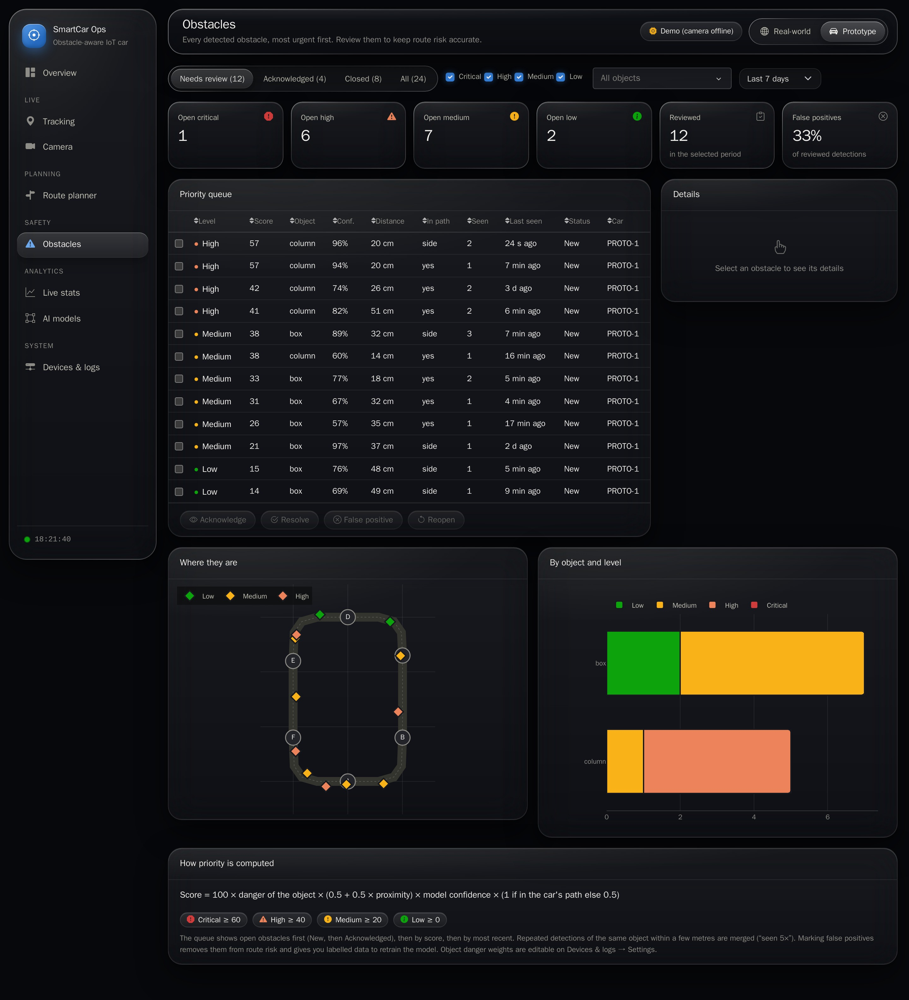 |

- **Real world.** Three vehicles drive on the OpenStreetMap graph of the Latin Quarter (309 intersections, 406 segments). CAR-01's dashcam plays real road clips through the two road models, and each detection appears on the map ahead of the car.
- **Prototype.** The car and its two boxes on the track. The boxes are always avoided on the inside, and the estimated detour path is drawn as a dotted orange line.

More screenshots: [`screenshots/`](screenshots/).

---

## Quick start

You only need **Docker Desktop**.

```bash
git clone https://github.com/Hatim-elaalgi/SmartCar-Ops.git
cd SmartCar-Ops
cp .env.example .env          # optional settings (camera IP, subnets, models…)
docker compose up --build
```

Open **http://localhost:8050**. Demo data is generated on first start, and the trained ONNX models are already in [`models/`](models/).

- **No ESP32-CAM?** `docker compose --profile fakecam up` starts a fake camera.
- **Tests:** `docker compose run --rm --no-deps dashboard python -m tests.smoke_test`
- **Training:** `docker compose --profile train up -d trainer`, then open the notebooks on the Jupyter server at `localhost:8888`.

The full usage guide covers camera discovery, plugging in your own model, training, using your own city and the tests: **[`docs/USAGE.md`](docs/USAGE.md)**.

---

## Repository layout

```
app.py, config.py      Dash app shell, camera relay route, all settings (env variables)
pages/                 one file per page (overview, tracking, camera, planner, obstacles, stats, models, system)
components/            theme, UI pieces, map / track figures
core/                  database, obstacles + severity, trips, events, road/track network, routing, toy-car model
sources/               camera service, dashcam, perception, ONNX YOLO detector, fleet and prototype simulators
models/                trained ONNX models + profiles + registry.json (real test metrics)
training/              training notebooks + generators, Docker image, evaluation scripts, report/ (metrics, figures)
datasets/toy/          prototype dataset (SAM 2 labels) and recorded ESP32-CAM frames
firmware/arduino_car/  Arduino sketch (line following + obstacle detour)
resources/             real road graph (OSM) and default tape track
demo/videos/           dashcam clips for the Real-world demo (sources and licences in CREDITS.md)
tools/, tests/         demo-data seeding, OSM graph builder; smoke and end-to-end tests
rapport/               the LaTeX report and its compiled PDF
docs/USAGE.md          detailed usage guide
```

---

## Credits

- [Ultralytics YOLO26](https://docs.ultralytics.com/) and the COCO pretrained weights; [SAM 2](https://github.com/facebookresearch/sam2) (Meta) for automatic labelling.
- *Potholes under challenging conditions*: Bučko et al., *Sensors* 2022 (CC BY 4.0). *ROADWork*: Ghosh et al., ICCV 2025, CMU (ODC-By 1.0).
- Map data © OpenStreetMap contributors. Demo dashcam clips: see [`demo/videos/CREDITS.md`](demo/videos/CREDITS.md).
- Dash, Plotly, NetworkX, ONNX Runtime, OpenCV.
